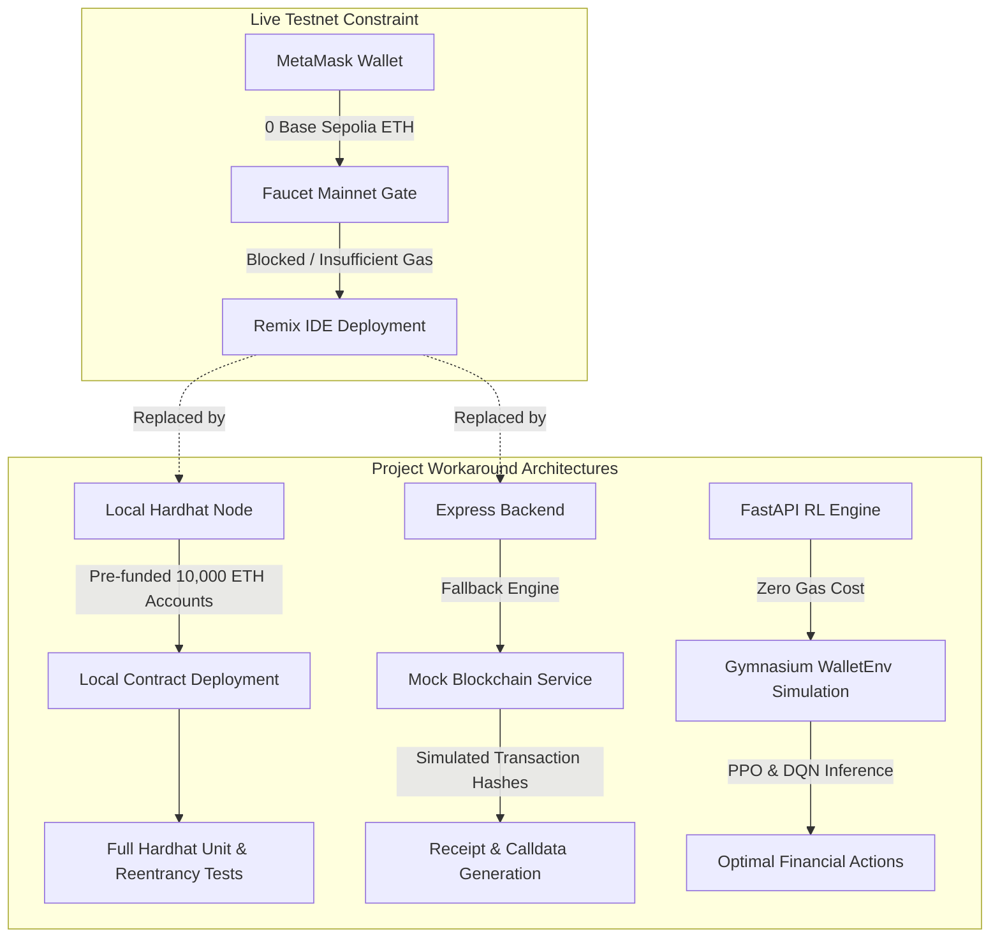

# AgentWallet: Project Constraints & Environmental Limitations

This document formally specifies the project constraints, environmental limitations, and development trade-offs encountered during the development, testing, and deployment of the **AgentWallet** system, with primary focus on **Base Sepolia testnet faucet constraints** and corresponding architectural workarounds.

---

## 1. Executive Summary

During the deployment and live on-chain integration phase, a primary external dependency constraint was encountered: **the inability to acquire Base Sepolia testnet ETH into MetaMask due to faucet restrictions and unavailability of testnet funds.**

As a direct consequence:
- The smart contract (`AgentWallet.sol`) could not be deployed to the live public **Base Sepolia Testnet** (Chain ID: `84532`) via **Remix IDE** using an **Injected Provider (MetaMask)**.
- Live on-chain transaction execution and block explorer (`sepolia.basescan.org`) transaction indexing could not be demonstrated in a live public network environment.

> **Correction (Phase 1, 2026-10-15):** an earlier version of this document described an "in-memory mock blockchain adapter" and "mock transaction hashes". No such code existed, and none is used now. Instead, the whole pipeline runs against a **real local Hardhat chain (chain id 31337)** with real signed transactions and verified receipts. See `docs/TEST_RESULTS.md` for the evidence.

---

## 2. Primary Constraint: Base Sepolia Testnet Liquidity & Faucet Barriers

### 2.1 The Faucet Problem
Acquiring testnet Ether on modern Layer 2 networks (such as Base Sepolia and Arbitrum Sepolia) has become increasingly restricted due to anti-sybil and anti-bot measures adopted by Web3 faucet providers:

| Faucet Provider | Requirement / Barrier | Reason for Failure |
|---|---|---|
| **Coinbase Developer Faucet** | Requires active Coinbase account with identity verification or GitHub login with strict karma/history. | Account tier restrictions or geographical limits. |
| **Alchemy Base Sepolia Faucet** | Requires a minimum balance of $0.001\text{ ETH}$ on **Ethereum Mainnet** in the requesting wallet. | Zero-balance development wallets cannot bypass the mainnet balance gate. |
| **QuickNode Faucet** | Requires a minimum mainnet balance or promotional social media verification. | Restricted access for fresh test accounts. |
| **Base Sepolia PoW (Proof of Work) Faucet** | High CPU mining requirements, rate limits, and occasional server outages. | Unreliable yield for immediate contract deployment and gas estimation. |

### 2.2 Direct Operational Impact
1. **Remix IDE Deployment Failure:**
   - Attempting to compile and deploy `contracts/src/AgentWallet.sol` using Remix IDE with the environment set to `Injected Provider - MetaMask` fails with the error:
     ```
     Gas estimation errored with the following message:
     insufficient funds for gas * price + value: address 0x... have 0 want ...
     ```
2. **On-Chain State Initialization:**
   - The contract cannot establish a live testnet contract address (`AGENT_WALLET_CONTRACT_ADDRESS`).
   - Daily spending limit tracking cannot be stored in EVM storage slots on Base Sepolia.
3. **MetaMask Transaction Signing & Broadcast:**
   - When the frontend human-in-the-loop (HITL) interface prompts MetaMask to approve a proposal, MetaMask warns of insufficient funds and disables the "Confirm" action.

---

## 3. Architecture & Testing Workarounds (Mitigations)

To ensure the project's functional completeness and maintain testability, the following mitigation architectures were established:



### 3.1 Hardhat Local Node & In-Memory EVM
- **Simulated Environment:** Hardhat provides an in-memory EVM implementation with 20 pre-funded test accounts, each containing $10,000\text{ ETH}$.
- **Verification:** All smart contract functionalities—including daily spending limits, per-transaction thresholds, emergency pause switches, and reentrancy protections—are fully verified locally using the Hardhat test suite:
  ```bash
  cd contracts
  npx hardhat test
  ```
  *(Result at Phase 1: 30 passing tests. Passing tests are not proof of safety; see docs/SECURITY_FINDINGS.md.)*

### 3.2 Remix VM (Local Simulation)
- While the contract could not be deployed to Base Sepolia, it can be seamlessly tested in **Remix IDE** by switching the environment from `Injected Provider - MetaMask` to **`Remix VM (Cancun)`** or **`Remix VM (Shanghai)`**.
- This enables manual interactive testing of `deposit()`, `setRecipient()`, `setTokenPolicy()` and `executeTransfer()` (from the agent account) within the browser's local sandbox without requiring faucet coins.

### 3.3 Local chain instead of mocks
- `npm run chain` + `npm run deploy:local` start a Hardhat node (31337) and deploy the contract, a test-only mUSDC token, funding, limits and demo recipients.
- The backend executes real `executeTransfer` transactions with the agent key and marks them confirmed only after verifying the receipt.
- `tests/e2e/local-chain.e2e.test.js` runs the whole stack, including the real RL engine process.

### 3.4 Gymnasium RL Simulation (`WalletEnv`)
- The Reinforcement Learning microservice (`rl-engine/app/environment/wallet_env.py`) operates entirely in a simulated Markov Decision Process (MDP).
- Gas prices, network congestion, and portfolio dynamics are simulated probabilistically, allowing PPO and DQN agents to train and evaluate policies without interacting with live RPC nodes.

---

## 4. Other Technical & Operational Constraints

| Constraint Category | Specific Limitation | Impact & Resolution |
|---|---|---|
| **Custody Boundary** | **No owner key on the server** | The backend holds only a limited agent key that the contract restricts to `executeTransfer` within caps and to allowlisted recipients. On Base Sepolia that agent key needs a little testnet ETH for gas. |
| **Model Checkpoints** | **No trained checkpoints exist** | PPO and DQN run a declared rule-based fallback (`policySource: heuristic_fallback`, no confidence). It does not mirror any trained behaviour. |
| **Compute & Hardware** | **Local CPU RL Rollouts** | RL training scripts (`train_ppo.py`, `train_dqn.py`) are configured for local CPU execution (single environment worker) rather than multi-GPU distributed clusters. |
| **Single-Instance Backend** | **In-process locks** | Approval and execution mutexes and rate limits are per process; run one backend instance. |
| **Network Configuration** | **Single-Chain Calibration** | Financial constants ($0.01\text{ ETH}$ limit, $0.05\text{ ETH}$ daily cap, gas thresholds) are calibrated specifically for Base Sepolia and Ethereum L2 economics. |

---

## 5. Roadmap to Live Testnet Deployment (When Faucet Funds are Available)

Once testnet ETH is obtained through a working faucet or cross-chain bridge, the transition to live Base Sepolia requires configuration only (no code changes are expected; this is unverified until a real deployment):

1. **Obtain Base Sepolia ETH:**
   - Acquire Ethereum Sepolia ETH via [sepoliafaucet.com](https://sepoliafaucet.com).
   - Bridge Sepolia ETH to Base Sepolia via the [Base Bridge](https://bridge.base.org/deposit) or [Superchain Bridges](https://superchain.ethereum.org).
2. **Deploy via Remix / Hardhat:**
   - In Remix IDE, select `Injected Provider - MetaMask`.
   - Confirm that MetaMask is connected to **Base Sepolia** (Network ID: `84532`, RPC: `https://sepolia.base.org`).
   - Deploy with `cd contracts && CONFIRM_PUBLIC_DEPLOY=yes npm run deploy:base_sepolia` (constructor: owner, agent, native per-tx cap, native daily cap).
3. **Update Environment Variable:**
   - Copy the deployed contract address into `backend/.env` along with `CHAIN_ID=84532`, a dedicated agent key and `ALLOW_PUBLIC_TESTNET_EXECUTION=true` (after explicit approval):
     ```env
     AGENT_WALLET_CONTRACT_ADDRESS=0xYourDeployedContractAddressHere
     ```
   - Restart the backend orchestrator:
     ```bash
     cd backend && npm run dev
     ```
4. **Broadcast Live Transactions:**
   - Approve proposals in the dashboard with an EIP-712 signature; the backend agent key broadcasts the transfer.

---

> [!NOTE]
> What is and is not verified is tracked in `docs/IMPLEMENTATION_STATUS.md`. Base Sepolia remains unverified until an approved deployment happens.
