# AgentWallet — Architecture Specification

## 1. High-Level Architecture Overview

AgentWallet is composed of five decoupled layers designed to isolate untrusted machine learning inferences from financial execution and key custody.

```mermaid
flowchart TD
    subgraph Browser ["Client Tier (Browser)"]
        UI["React + Vite Dashboard (Verdant Design)"]
        MM["MetaMask Extension (EIP-1193 Signer)"]
        UI <-->|Request Signatures| MM
    end

    subgraph BackendTier ["Orchestration & Verification Tier (Node.js)"]
        API["Express REST API"]
        ORCH["Agent Orchestrator"]
        SAFETY["Deterministic Safety Engine"]
        REPO["PostgreSQL Repositories"]
        API --> ORCH
        ORCH --> SAFETY
        ORCH --> REPO
    end

    subgraph RLTier ["Intelligence Tier (Python FastAPI)"]
        RL_API["FastAPI RL Server"]
        ENV["Wallet Simulation Env (Gymnasium)"]
        PPO["PPO Agent (Actor-Critic)"]
        DQN["DQN Agent (Target Net + Replay)"]
        RL_API --> PPO
        RL_API --> DQN
        ENV -.->|Training Loop| PPO
        ENV -.->|Training Loop| DQN
    end

    subgraph ChainTier ["Settlement Tier (EVM Blockchain)"]
        NODE["EVM RPC Provider (Base Sepolia Testnet)"]
        CONTRACT["AgentWallet.sol Smart Contract"]
        NODE --> CONTRACT
    end

    subgraph DatabaseTier ["Persistence Tier (PostgreSQL)"]
        DB[("agentwallet_db")]
    end

    %% Interactions
    UI <-->|REST API (Proposals, Audit, Telemetry)| API
    MM -->|Broadcast Signed Tx| NODE
    ORCH <-->|Read State / Verify Receipts| NODE
    ORCH <-->|Inference Request / Response| RL_API
    REPO <-->|Query & Persist Logs| DB
```

---

## 2. The Nine-Stage Execution Pipeline

Every financial action undergoes nine deterministic checkpoints before execution:

```mermaid
flowchart LR
    S1["1. State Observation"] --> S2["2. RL Inference"]
    S2 --> S3["3. Proposal Generation"]
    S3 --> S4["4. Deterministic Validation"]
    S4 --> S5["5. User Approval (HITL)"]
    S5 --> S6["6. MetaMask Signing"]
    S6 --> S7["7. Blockchain Broadcast"]
    S7 --> S8["8. Receipt Verification"]
    S8 --> S9["9. Audit Logging"]
```



1. **State Observation:**
   The backend queries the EVM RPC node for the wallet's current native balance, daily spent amount, gas base fee, and contract pause status.
2. **RL Inference:**
   The normalized observation vector is submitted to the FastAPI `rl-engine`. The active agent (PPO or DQN) evaluates the observation and computes action values / policy distribution.
3. **Proposed Action Generation:**
   The agent outputs an action proposal containing:
   - Action type: `HOLD`, `MICRO_PAYMENT`, `STANDARD_REBALANCE`, or `DEFENSIVE_STABILIZE`
   - Execution parameters: amount in ETH, target recipient, gas ceiling
   - Confidence score and natural language explainability rationale.
4. **Deterministic Validation:**
   The backend `safetyService` inspects the proposal independently of the ML model:
   - Does `amountEth <= perTransactionLimit`?
   - Does `dailySpent + amountEth <= dailySpendingLimit`?
   - Is `baseFeeGwei <= MAX_GAS_BASE_FEE_GWEI`?
   - Is the recipient an approved contract or non-zero address?
   If any check fails, the proposal is rejected before reaching the user.
5. **User Approval (Human-in-the-Loop):**
   Valid proposals are published to the frontend dashboard. The proposal displays a countdown TTL timer (default 180 seconds). The human operator reviews the intent, parameters, and AI rationale.
6. **MetaMask Transaction Signing:**
   If the user approves, the frontend formats the smart contract transaction (`executePayment(recipient, amount)`). The user signs the transaction in MetaMask via standard EIP-1193 RPC.
7. **Blockchain Broadcast:**
   MetaMask or the client provider transmits the signed transaction payload to the EVM network.
8. **Transaction Receipt Verification:**
   The backend tracks the mined transaction hash, waits for required block confirmations, and checks whether the receipt status succeeded (`0x1`) or reverted (`0x0`).
9. **Audit Logging:**
   The full lifecycle event (observation, agent reasoning, safety validation, user signature, and on-chain tx receipt) is immutably logged in PostgreSQL.

---

## 3. Communication Protocols

| Interface | Protocol | Request / Response Format |
|---|---|---|
| Frontend ↔ Backend | HTTP / HTTPS + WebSocket | JSON (REST API) |
| Backend ↔ RL Engine | HTTP / HTTPS | JSON (Pydantic / OpenAPI) |
| Frontend ↔ MetaMask | EIP-1193 | Window Provider RPC (`eth_sendTransaction`) |
| Backend ↔ Blockchain | JSON-RPC (HTTP) | ethers.js JsonRpcProvider |
| Backend ↔ Database | PostgreSQL Protocol | `pg` connection pool with parameterized SQL |
