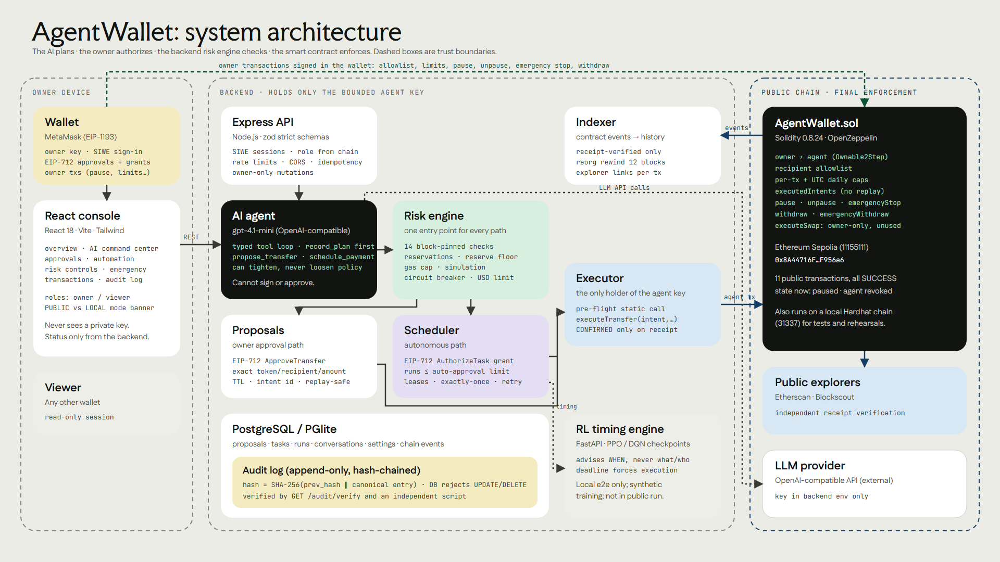

# AgentWallet: technical documentation (Deliverable 01)

**Challenge:** FinTechathon, Autonomous On-chain Wallet. **Revision:** branch `feature/phase-1-secure-foundation` at `90c1849`, plus uncommitted work (UI redesign, public-run tooling, submission package, and on 2026-10-17 the execution-time re-verification fixes and contract v2). **Date:** 2026-10-16, updated 2026-10-17.

> **Contract versions.** Everything tagged **[PUBLIC]** ran on contract **v1** (Ethereum Sepolia `0x8A44…956a6`). On v1 the
> owner's EIP-712 approval is verified by the backend; the contract trusts the agent key within its caps.
> Contract **v2** verifies the owner's approval and task grants **on-chain**. It is **[LOCAL]**-tested in full and has a **complete [PUBLIC] Sepolia run**
> (`0x3C9389E704331B8a12381F9ab5A68a7F3F59582F`, 12/12 SUCCESS, `evidence/sepolia-v2-full/`), after an earlier partial run (`0x23bA…4458`).
> See [docs/V2_PUBLIC_RUNS.md](../../docs/V2_PUBLIC_RUNS.md).
> See [docs/CONTRACT_V2.md](../../docs/CONTRACT_V2.md).

**Status legend.** Every capability below is tagged:

| Tag | Meaning |
|---|---|
| **[PUBLIC]** | Demonstrated on Ethereum Sepolia, with transaction hashes. |
| **[PUBLIC-OFFCHAIN]** | Happened during the public run but leaves no chain artifact. |
| **[LOCAL]** | Implemented and covered by automated tests or recordings on a local Hardhat chain. |
| **[IMPLEMENTED]** | Code exists, not exercised end to end. |
| **[PLANNED]** | Not built. |

---

## 1. What AgentWallet is

AgentWallet is a smart-contract treasury that an AI agent can operate, without the agent ever being trusted. It works in four steps:

- **The AI plans:** gpt-4.1-mini turns natural language into typed tool calls.
- **The owner authorizes:** an EIP-712 signature for one transfer, or a bounded task grant for autonomous runs.
- **Trusted backend code checks:** 14 block-pinned policy checks, including a pre-flight simulation (15 for scheduled task runs, which add AUTOMATION_ACTIVE).
- **The contract enforces:** recipient allowlist, per-transaction and daily caps, one-time intents, pause and emergency stop.

Security does not depend on the model behaving well.

The public evidence is in `evidence/sepolia/`. The contract is `0x8A44716Efabb6Ce401291B91D4427149CaF956a6` on Ethereum Sepolia. It has 11 successful transactions, including an AI-drafted owner-approved transfer and an AI-drafted autonomous transfer executed under a signed grant.

## 2. System architecture



The editable source is `architecture.svg`; it has three trust boundaries. `architecture-v2.svg` / `.png` shows the same system as a six-stage payment flow.

> **Contract version shown.** Both diagrams show the contract **as deployed on Ethereum Sepolia (v1)**: the agent key calls `executeTransfer`, and the owner's EIP-712 approval and task grants are verified by the backend. The current source (`contracts/src/AgentWallet.sol`, **v2**, publicly run on Sepolia at `0x3C93…582F`, see [V2_PUBLIC_RUNS.md](../../docs/V2_PUBLIC_RUNS.md)) replaces `executeTransfer` with `executeApprovedTransfer` and `executeGrantTransfer`. Those verify the owner's signature, the signed deadline and the grant bounds **on-chain**, and add `revokeGrant` / `cancelIntent`. Everything else in the diagrams is unchanged in v2. See [docs/CONTRACT_V2.md](../../docs/CONTRACT_V2.md).

| Layer | Component | Technology | Trust |
|---|---|---|---|
| Owner device | Wallet | MetaMask (EIP-1193). In the public run: a test-only EIP-1193 bridge | Custody: holds the owner key |
| | Console | React 18, Vite 5, Tailwind 3.4, ethers 6 | Untrusted UI: shows backend data, asks the wallet to sign |
| Backend | API | Node.js, Express, zod strict schemas, rate limits, idempotency keys | Trusted policy code |
| | AI agent | OpenAI-compatible provider (`gpt-4.1-mini`); Anthropic provider also supported | Untrusted output |
| | Risk engine | `riskEngine.js` → `policyService.js` | Trusted |
| | Proposal service, scheduler, executor, indexer | Node services | Trusted; the executor holds the only hot key (agent) |
| | Database | PostgreSQL or PGlite (embedded Postgres) | Persistence, hash-chained audit log |
| | RL timing engine | Python FastAPI, Stable-Baselines3 PPO/DQN | Untrusted output; advisory only |
| Chain | `AgentWallet.sol` | Solidity 0.8.24, OpenZeppelin 5, Hardhat 2.29 | Final enforcement |

### Technology stack

- **Contracts:** Solidity 0.8.24, OpenZeppelin (Ownable2Step, ReentrancyGuard, SafeERC20, Pausable), Hardhat, ethers 6.
- **Backend:** Node 20, Express, zod, ethers 6.17, `@electric-sql/pglite` / `pg`, OpenAI-compatible and Anthropic SDK providers.
- **Frontend:** React 18, react-router 6.30, Vite 5, Tailwind 3.4, Material Symbols. Fonts: Faculty Glyphic, Fustat, JetBrains Mono.
- **RL:** Python, Gymnasium, Stable-Baselines3, FastAPI.
- **Testing:** Hardhat/Mocha, `node:test`, Vitest, Playwright (test wallet bridge and real MetaMask 13.52.0).

## 3. AI-agent architecture  [PUBLIC]

Files: `backend/src/services/agentChatService.js`, `backend/src/llm/providers.js`, `backend/src/llm/tools.js`.

1. **Loop.** A manual tool loop with at most `LLM_MAX_MODEL_CALLS` per turn; the public runs used 4 model calls per turn. Refusal or truncated output runs no tools.
2. **Tools.** Strict JSON schemas (`additionalProperties: false`), validated again with zod before execution.
   - Read tools: `list_recipients`, portfolio and spending.
   - Plan tool: `record_plan`, which must come first in a turn before any action tool.
   - Action tools: `propose_transfer` and `schedule_payment`. Both create drafts only.
   - Tighten-only tools: raise a reserve floor, pause automation, cancel a task.
   - There is **no** tool to approve, sign, execute, withdraw, resume or loosen.
3. **Recipients** must be on the on-chain allowlist; this is checked in code. Labels, memos and tool results are treated as data, not instructions.
4. **Memory and monitoring.** Each turn persists the user message, plan, every tool invocation (input, output, status, error), the final text, the resulting actions, the model and the model-call count. These records appear in the console (AI agent page) and in `EVIDENCE.md` ("AI agent execution log").

**Public evidence.** gpt-4.1-mini drafted both public transfers.
- Owner-approved: instruction → `list_recipients` → `record_plan` → `propose_transfer` → proposal `2556bd41`.
- Autonomous: → `schedule_payment` → task `aa334b60`.

Source: `evidence/sepolia/EVIDENCE.md` §AI agent execution log. Clips: `02-ai-command`, `11-audit-monitoring`.

**Model reliability.** The live gpt-4.1-mini suite (`backend/test/live/agent.live.test.js`) passed 19/19 safety assertions in each of 4 runs on 2026-10-15 (`docs/LIVE_LLM_VERIFICATION.md`). Observed weaknesses:
- One run raised a reserve floor nobody asked for (tighten-only, so harmless).
- A pronoun-only recipient was once guessed before a prompt fix.

Mitigation: drafts only, plus an owner signature or bounded grant (risk R9).

## 4. Core algorithms

### 4.1 Transaction planning and proposal  [PUBLIC]

1. A proposal, from the owner, the agent or a task run, is normalized to integer base units with a checksummed recipient.
2. It is given a deterministic `intentId` (bytes32), which the contract accepts only once.
3. It is given a TTL (`PROPOSAL_TTL_SECONDS`).
4. The EIP-712 `ApproveTransfer` typed data covers: proposal id, intent id, token, recipient, amount, deadline.

### 4.2 Risk evaluation  [PUBLIC]

`riskEngine.assessTransfer` is the single entry point for every path. It runs at creation, again at approval, and again in executor pre-flight.

```
snapshot(block N) + allowlist + in-flight reservations + owner settings + prices
 → AGENT_ACTIVE, CONTRACT_ACTIVE, EXECUTOR_AUTHORIZED, TOKEN_SUPPORTED, RECIPIENT_VALID, RECIPIENT_ALLOWLISTED,
   RECIPIENT_TYPE, AMOUNT_POSITIVE, PER_TX_LIMIT, DAILY_LIMIT, BALANCE_AND_RESERVE, (USD_DAILY_LIMIT), GAS_PRICE,
   EXECUTOR_GAS, (AUTOMATION_ACTIVE for task runs)
 → SIMULATION: static call + gas estimate from the executor address
 → outcome: REJECTED | DEFERRED | ESCALATED | AUTO_APPROVED | ALLOWED_PENDING_APPROVAL, with a headline and blockedBy
```

**Public evidence.**
- The owner-approved transfer passed all 14 checks at block 11926666.
- The 0.0003 ETH draft failed PER_TX_LIMIT (0.0003 vs 0.0002 cap) and BALANCE_AND_RESERVE (needs 0.0004, holds 0.0003), and was never signed or broadcast. Audit entry #10 is `PROPOSAL_POLICY_REJECTED`, with no transaction.

Clips: `03-risk-engine`, `04-rejected-transaction`.

### 4.3 Owner authorization  [PUBLIC]

- The owner signs `ApproveTransfer`. The backend recovers the signer, checks it against the live `owner()`, re-runs policy, and moves the state machine `AWAITING_APPROVAL → APPROVED` atomically. Idempotency-Key is required.
- Public transaction: `0x2c83a855…2e37fb`. Signed by the test-only EIP-1193 bridge with the owner key; this was programmatic, not MetaMask.
- Real MetaMask signing of the same typed data: **[LOCAL]**, clip `12-metamask-local`, `evidence/submission/footage/metamask/checklist-report.md`.
- **Execution-time re-verification [LOCAL], both contract versions:** immediately before signing, the executor checks:
  - that the signed `deadline` has not passed; it is the execution deadline and is never extended, and approvals with less than 15 s left are refused;
  - that the stored signature still recovers to the recorded approver over the exact row being executed;
  - that the approver is still `owner()`.

  Tests: `backend/test/authorization.regression.test.js`.
- **On-chain verification [LOCAL, v2 only]:** `executeApprovedTransfer(ApproveTransfer, signature)` verifies the same typed data against `owner()` (EOA or ERC-1271) and the deadline in the contract. The public transaction above used v1, where this check was off-chain.

### 4.4 EIP-712 bounded grants and autonomous execution  [PUBLIC]

`AuthorizeTask{taskId, token, recipient, amountPerRun, maxRuns, maxTotal, validUntil, scheduleHash, executionWindowSeconds}` is signed once by the owner. The scheduler (`schedulerService.js`) then works as follows:

```
tick → lease due tasks → task_run (run_key = taskId:occurrence) → [RL timing may DEFER inside the window]
     → claim (compare-and-set) → reserve grant bounds atomically → proposal (risk engine)
     → routeApproval: AUTO_GRANT if within the grant AND ≤ owner's auto-approval limit, else ESCALATE to the owner
     → executor → receipt → CONFIRMED
```

**Double execution is prevented at five levels:**
- task lease;
- `run_key` uniqueness;
- the claim compare-and-set;
- the proposal state machine;
- the contract's `executedIntents`.

Circuit breakers:
- N consecutive failures pause the task;
- the hourly autonomous outflow cap escalates and pauses automation.

**Grant integrity [LOCAL], both versions.** The scheduler and the executor rebuild the `AuthorizeTask` typed data from the task's database columns. They require it to equal the stored copy and verify the signature over the rebuild, so a task edited after signing escalates instead of auto-executing. Runs of cancelled or expired tasks are refused.

**On-chain grant enforcement [LOCAL, v2 only].** `executeGrantTransfer(AuthorizeTask, signature, intentId)` verifies the grant signature against `owner()` and enforces `validUntil` and per-grant `maxRuns`/`maxTotal` counters on-chain. The owner can call `revokeGrant`. The schedule itself remains off-chain.

**Public evidence (v1).** Task `aa334b60` was signed at 10:09:07 UTC (audit #15). The run was auto-approved by the grant at 10:11:26 (#18, #19). Transaction `0xedeb6b97…e3cec3` (block 11926686) was sent by the agent key with no per-transfer owner signature (`approval_kind = TASK_GRANT`). Clips: `06-autonomous-execution`, `15-end-to-end`.

### 4.5 Smart-contract interactions  [PUBLIC: v1]

| Function | Caller | Enforcement | Public evidence |
|---|---|---|---|
| `executeTransfer(intent, token, recipient, amount)` (**v1 only**; removed in v2) | agent only | allowlist, enabled token, per-tx cap, UTC-day cap, intent unused, not paused, nonReentrant | `0x2c83a855…`, `0xedeb6b97…` (v1) |
| `executeApprovedTransfer(ApproveTransfer, ownerSig)` (**v2**) | agent only | owner EIP-712 signature against `owner()`, signed deadline, plus every v1 check | **[LOCAL]** only |
| `executeGrantTransfer(AuthorizeTask, ownerSig, intent)` (**v2**) | agent only | grant signature against `owner()`, `validUntil`, on-chain run/total counters, revocation, plus every v1 check | **[LOCAL]** only |
| `revokeGrant`, `cancelIntent` (**v2**) | owner | revoke one grant or one approved intent | **[LOCAL]** only |
| `setRecipient` | owner | non-zero, not self | `0xf6306fe5…` |
| `deposit` | anyone | | `0xe593d6d3…` |
| `pause` / `unpause` | owner | | `0x2a2eeb50…`, `0x00b0dc31…` |
| `emergencyStop` | owner | pause + revoke agent atomically | `0xfe627133…` |
| `withdraw` / `emergencyWithdraw` | owner | emergency only while paused | `0x6c8fb074…` |
| `setTokenPolicy`, `setAgent`, `revokeAgent` | owner | owner ≠ agent | constructor (deployment) |
| `executeSwap`, `setSwapRouter` | owner only | router allowlist, minOut, deadline ≤ 30 min, shared caps | **[LOCAL]** mock router tests only; present in the deployed bytecode; no router allowlisted; not wired in backend or UI |

### 4.6 Audit system  [PUBLIC-OFFCHAIN]

- Rule: `hash_n = SHA-256(hash_{n-1} ‖ canonical([occurredAt, actor, action, entityType, entityId, details]))`, with key-sorted JSON and genesis = 64 zeros.
- The database rejects UPDATE and DELETE on `audit_log` (trigger).
- Verification:
  - `GET /api/audit/verify`;
  - an independent re-implementation, `submission/tools/verify-audit-chain.mjs`. It ran on a copy of the public-run database on 2026-10-16: **22 entries, CHAIN VALID**, head `8ba71bb2…660198`. Entries #7–#9 and #20–#21 carry the public transaction hashes. See clip `11-audit-monitoring` and `evidence/submission/footage/term-audit.log`.
- Limitation: the chain head is not anchored on-chain (risk R11).

### 4.7 Indexer and receipt verification  [PUBLIC]

- Contract events are indexed in bounded `eth_getLogs` ranges: 200 blocks on Base Sepolia, 2000 on Sepolia. Reorgs rewind 12 blocks.
- History shows only receipt-verified transactions, with explorer links.
- An independent read-only check (`submission/tools/verify-receipts.mjs`) confirmed all 11 public transactions on 2026-10-16. Output: `submission/06-execution-evidence/receipts-verified.json`.

### 4.8 RL execution-timing engine  [LOCAL]

| Aspect | Detail |
|---|---|
| Task | Given an authorized payment with a window of W 15-minute steps, choose WAIT or EXECUTE. |
| Reward | Minus the relative gas at execution, minus a small per-step delay cost. |
| Training | SB3 PPO and DQN on a **synthetic** gas process. Checkpoints selected on validation seeds and reported on disjoint test seeds, with baselines and bootstrap confidence intervals (`docs/ppo-vs-dqn.md`). |
| Integration status | Wired into the scheduler (opt-in per task, `useRlTiming`). Covered by the local e2e test "trained RL checkpoints serve genuine timing inference …" and the scheduler RL test. |
| Not used in the public run | The task did not opt in, and the RL service was not deployed. |
| Limitation | Trained on synthetic data and out of distribution on real chains (risk R14). |

### 4.9 Portfolio  [LOCAL]

- On-chain balances and caps are **[PUBLIC]**.
- USD valuation exists only where an AggregatorV3 feed is configured. Local feeds are labelled `local-mock-feed (synthetic)`; none are configured on Sepolia.
- Allocation targets and drift are advisory. Nothing rebalances (see §9).

## 5. Permission tiers

The full matrix is in Deliverable 05. In summary:

| Tier | Holder | Can | Enforced by |
|---|---|---|---|
| T0 Anonymous | anyone | `/config`, request a nonce | backend |
| T1 Viewer | any other SIWE wallet | read only; 403 on every mutation | backend (owner role read live from `owner()`) |
| T2 LLM agent | gpt-4.1-mini | read, draft, tighten | backend (no such tools exist) |
| T3 Scheduler | backend, under a grant | runs within the grant and the auto-approval limit | backend + contract |
| T4 Agent key | executor | v1: `executeTransfer` only. v2: only transfers with an owner signature or grant verified on-chain | contract |
| T5 Owner | wallet | everything else | contract (Ownable2Step, renounce disabled) |

Clip: `10-permission-security`.

## 6. Data flow (autonomous payment, as in the public run)

```
owner types instruction ─▶ console ─REST─▶ agentChatService ─▶ gpt-4.1-mini ─tool calls─▶ schedule_payment (draft task)
owner signs AuthorizeTask (EIP-712) ─▶ backend verifies signer == owner() ─▶ task ACTIVE
scheduler tick ─▶ run ─▶ riskEngine (block-pinned) ─▶ AUTO_GRANT ─▶ executor (agent key) ─▶ executeTransfer
contract checks allowlist / caps / intent / pause ─▶ TransferExecuted ─▶ receipt verified ─▶ indexer ─▶ history
every step ─▶ audit_log (hash-chained)
```

## 7. Failure handling

| Failure | Behaviour | Evidence |
|---|---|---|
| Policy violation | Proposal `POLICY_REJECTED`; nothing signed or sent | public #10; `api.execution.test.js` |
| State changed between creation and approval | Re-check at approval refuses | "approval re-checks policy …" |
| Concurrent approvals | Reservations stop over-commit; exactly one execution | `api.execution.test.js` |
| Transaction reverts | FAILED with error code; run FAILED; audit | `scheduler.test.js` "transaction failure on-chain" |
| Crash mid-run | CLAIMED run recovered and executed exactly once | `api.restart.test.js`, scheduler restart test |
| Transient RPC error | RETRY_WAIT with exponential backoff, bounded | scheduler tests |
| Repeated failures | Circuit breaker pauses the task | scheduler tests |
| LLM refusal, truncation or invalid tool input | No tools run; the error is reported | `agent.chat.test.js` |
| RL service down | Run executes at once; the reason is recorded | scheduler RL test |
| Public RPC log-range limits | Bounded ranges | `indexer.range.test.js` |
| Public run cleanup hang (found in the real run) | Idempotent stop; gate reset first | `deploy.gate.test.js`, `RUN_NOTES.md` |

## 8. Security boundaries (summary)

- The owner key never reaches the backend. In the automated public run, a local script held it (test-only bridge, risk R17).
- The backend holds only the agent key. The v1 contract limits it to `executeTransfer` within caps and the allowlist. The v2 contract also requires the owner's signature for every transfer.
- The LLM and RL outputs are untrusted. Neither can sign, approve, change recipients or loosen limits.
- Network allowlist: 31337, 84532 and 11155111 only. Mainnets are refused. Public Hardhat keys are refused on public networks.
- Public deploys require `CONFIRM_PUBLIC_DEPLOY=yes`, which is currently `no`.

## 9. Implemented vs. planned

| Capability | Status |
|---|---|
| AI-drafted owner-approved transfer | [PUBLIC] |
| AI-drafted autonomous transfer under a bounded grant | [PUBLIC] |
| Policy rejection of an unsafe AI draft | [PUBLIC-OFFCHAIN] |
| Pause, unpause, emergency stop, withdraw | [PUBLIC] |
| Real MetaMask flows (connect, SIWE, EIP-712, owner transactions, account and network switching) | [LOCAL]: 10/11 rows on 2026-10-16; row 9 needs a paid LLM call; 11/11 on 2026-10-15 |
| Recurring and conditional tasks, circuit breakers, restart recovery | [LOCAL] |
| RL timing (PPO/DQN) | [LOCAL], synthetic training |
| Multi-asset (ERC-20) treasury, USD valuation | [LOCAL] (mock token and synthetic feeds) |
| Owner-only swaps (`executeSwap`) | [IMPLEMENTED] in the contract and deployed bytecode; backend service unwired; no UI |
| Execution-time deadline and signature re-verification (audit F1, F3) | [LOCAL], both contract versions |
| On-chain owner-signature and grant verification, grant and intent revocation (contract v2, audit F2) | [LOCAL]: implemented and tested. [PUBLIC]: v2 Sepolia `0x3C93…582F`, 12/12 SUCCESS: owner signature verified on-chain (`0x564129e2…`), autonomous grant run (`0xbcdd8685…`), on-chain grant revocation (`0x4b8b8efd…`), 26/26 read-only checks. An earlier partial run (`0x23bA…`) reverted its grant run (day-boundary gas issue, fixed) |
| Policy-bounded treasury rebalancing | [PLANNED]: see `submission/scoring-readiness/SCORING_READINESS.md` §5 |
| On-chain anchoring of the audit head | [PLANNED] |
| Multisig owner | [PLANNED] (R1) |

## 10. Testing methodology

| Suite | Command | Result (2026-10-16) |
|---|---|---|
| Contracts | `cd contracts && npx hardhat test` | 35 passing |
| Backend | `cd backend && npm test` | 118/118. One timing-sensitive reservation test failed once under full-suite load; it passed in isolation 3/3 and in a full rerun |
| Frontend components | `cd frontend && npx vitest run` | 24/24 |
| Browser (test wallet bridge) | `cd frontend && npx playwright test` | 3 passed, 1 skipped (live LLM) |
| End-to-end (local chain) | `node --test tests/e2e/` | 8/8, recorded live in `term-e2e.webm` |
| Real MetaMask 13.52.0 | `cd frontend && npm run test:metamask` | 10 PASS, 1 BLOCKED (paid LLM), recorded |
| Live LLM | `LIVE_LLM=1 node --test test/live/` | 19/19 × 4 (2026-10-15) |
| Recorded demo rehearsal | `npm run demo:rehearse` | passed on the redesigned UI, 9 contract transactions, local |
| Public receipts | `node submission/tools/verify-receipts.mjs` | 11/11 SUCCESS |
| Audit chain (public-run DB copy) | `node submission/tools/verify-audit-chain.mjs` | 22 entries, valid |

The tests are adversarial by design:
- re-entrancy;
- randomized cap fuzzing;
- forged and foreign signatures;
- double approvals and duplicate scheduler instances;
- prompt injection in labels;
- invented recipients;
- loosening attempts.

## 11. Deployment architecture

| Environment | Chain | How | Status |
|---|---|---|---|
| Local | Hardhat 31337 | `npm run chain`, `npm run deploy:local`, `npm run dev:backend`, `npm run dev:frontend` | [LOCAL] |
| Public testnet | Ethereum Sepolia 11155111 | `npm run demo:sepolia -- --i-approve-sepolia-transactions` with `CONFIRM_PUBLIC_DEPLOY=yes` (two approvals). Separate backend profile `backend/.env.sepolia`, database `backend/data/sepolia`, record `contracts/deployments/sepolia.json` | [PUBLIC], 2026-10-16 (v1). That target is now frozen against re-runs. |
| Public testnet | Base Sepolia 84532 | Same tooling; runbook `docs/BASE_SEPOLIA_READINESS.md` | Prepared and rehearsed; not executed (faucet constraints) |
| Containers | | `docker-compose` files exist | Unbuilt (risk R16) |

Organizer guidance: "There are no restrictions on on-chain transactions." (`docs/ORGANIZER_GUIDANCE.md`). The team's reading is that public testnets are acceptable. This is an interpretation; the reply does not name a network.
